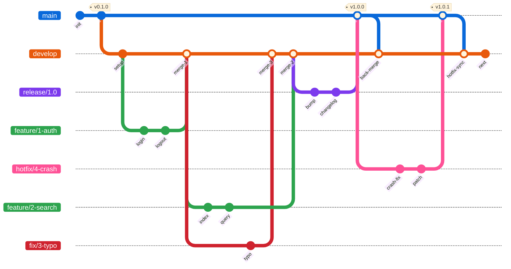

<div align="center">

# Git Workflow — Claude Code Skill

[](https://github.com/qubernetic/git-workflow-agent-skill/actions/workflows/lint.yml)
[](CHANGELOG.md)
[](LICENSE)
[](https://claude.ai/code)
[](https://conventionalcommits.org)
[](https://nvie.com/posts/a-successful-git-branching-model/)
[](https://semver.org)

A Claude Code skill that enforces a disciplined Gitflow-based development workflow with conventional commits, semantic versioning, and issue-driven branching.

[Installation](#installation) · [Usage](#usage) · [What It Enforces](#what-it-enforces) · [Contributing](CONTRIBUTING.md) · [Onboarding](ONBOARDING.md)

</div>

---

## Installation

Clone the repo and run the install script for your platform. The script creates a **symlink**, so the skill stays in sync with the repo automatically.

### Linux

```bash
git clone https://github.com/qubernetic/git-workflow-agent-skill.git
cd git-workflow-agent-skill
./scripts/install_linux.sh
```

### macOS

```bash
git clone https://github.com/qubernetic/git-workflow-agent-skill.git
cd git-workflow-agent-skill
./scripts/install_macos.sh
```

### Windows (PowerShell)

```powershell
git clone https://github.com/qubernetic/git-workflow-agent-skill.git
cd git-workflow-agent-skill
.\scripts\install_windows.ps1
```

> **Note:** Windows symlinks require Developer Mode enabled or an elevated terminal. The script falls back to a file copy if symlinks are unavailable.

### Uninstall

```bash
# Linux
./scripts/install_linux.sh --uninstall

# macOS
./scripts/install_macos.sh --uninstall
```

```powershell
# Windows
.\scripts\install_windows.ps1 -Uninstall
```

Uninstall removes the skill symlink and the agent hooks. It leaves the guard's user config and any per-repository git hooks in place. In each repository where you ran `enable --git-hooks`, delete `.git/hooks/commit-msg` and `.git/hooks/pre-push` (and rename any `<name>.local` hook back to `<name>`) before you delete the clone: those hooks call `hooks/guard.mjs` from the clone, so commits and pushes there fail once it is gone. `disable` does not remove them.

### Manual Installation

If you prefer not to use the scripts:

```bash
mkdir -p ~/.claude/skills/git-workflow
ln -s "$(pwd)/SKILL.md" ~/.claude/skills/git-workflow/SKILL.md
```

The skill will be automatically discovered on the next Claude Code session.

## Usage

The skill activates automatically when you ask Claude Code to perform any git operation:

```
> Commit my changes
> Create a branch for this feature
> Prepare a release for version 1.2.0
> I need to hotfix a production bug
```

Or invoke directly:

```
/git-workflow
```

## What It Enforces

| Rule | Description |
|------|-------------|
| **Gitflow branching** | `main`, `develop`, `feature/*`, `fix/*`, `docs/*`, `ci/*`, `perf/*`, `hotfix/*`, `release/*`, `epic/*` |
| **Epics** | Multi-slice plans run on an `epic/*` branch; slices merge freely, one reviewed epic PR reaches `develop` |
| **Conventional Commits** | Structured messages — `feat:`, `fix:`, `docs:`, `chore:`, etc. |
| **Atomic commits** | One logical change per commit, no mixed concerns |
| **`--no-ff` merges** | All merges into protected branches preserve branch topology |
| **No AI signatures** | No "Co-Authored-By" or "Generated by" lines |
| **Semantic Versioning** | `MAJOR.MINOR.PATCH` with proper bump rules |
| **Issue-driven workflow** | Every branch starts from an issue and closes it via PR |
| **PR-only merges** | `main` and `develop` are never committed to directly |
| **Conventional PR titles** | PR titles follow Conventional Commits format |

## Workflow Guard (optional)

The skill relies on the agent following the rules. The guard is optional tooling in `hooks/` that checks the mechanical ones before a command runs: no AI attribution, Conventional Commits, no commits on `main`/`develop`, branch names and their issues, no plain force-push (`--force-with-lease` only on your own branches) or `--no-verify`, `gh pr merge --merge` only, a human approval for merges into `main` and `develop`, and more (the full rule list is in the Enforcement section of `SKILL.md`). It needs `node` 20 or newer, has no dependencies, and fails open: if it cannot parse or query something, it allows the command and prints a warning.

### Install

The install scripts register the guard right after the skill symlink when `node` is found:

```bash
./scripts/install_linux.sh                 # or install_macos.sh; skill + agent hooks
./scripts/install_linux.sh --scope all     # guard active in every repository
./scripts/install_linux.sh --no-hooks      # skill only
```

```powershell
.\scripts\install_windows.ps1 -Scope all   # -NoHooks and -Uninstall work too
```

You can also ask Claude Code ("install the guard", "is the guard working?") or run the guard directly: `node /path/to/clone/hooks/guard.mjs install|update|doctor|repair|uninstall|enable|disable` (use the absolute path; `install` prints it, and `enable`/`disable` act on the repository of the current directory). `install` accepts `--scope opt-in|all` and `--harness claude,codex`. Re-running `install` without `--scope` keeps the scope you chose earlier. Run `doctor` to check the registration.

### Scope and per-repository config

- `opt-in` (default): the guard is active only in repositories that contain a `.git-workflow.json`. Create it by running, inside the target repository, `node /path/to/clone/hooks/guard.mjs enable` (add `--git-hooks` to install the `commit-msg` and `pre-push` git hooks too). `enable` acts on the repository of the current directory.
- `all`: active in every repository.

The scope lives in the user config (`$XDG_CONFIG_HOME/git-workflow-guard/config.json`, falling back to `~/.config/...`; on Windows `%APPDATA%\git-workflow-guard\config.json`). `.git-workflow.json` is optional settings, and `{}` is valid:

```json
{
  "protectedBranches": ["main", "develop"],
  "branchTypes": ["feature", "fix", "hotfix", "epic", "docs", "ci", "perf"],
  "attributionPatterns": [],
  "rules": { "merge-gate": "ask", "fresh-base": "warn", "tag-on-main": "off" }
}
```

A rule level is one of `on`, `off`, `warn`, `ask`, `deny`. `on` keeps the rule's default decision (the same as leaving the rule out); `off` disables it; `warn`, `ask` and `deny` replace its decision. `ask` becomes `deny` where the agent cannot ask, such as in the git hooks.

### Harness support

| Harness | Status |
|---------|--------|
| Claude Code | supported |
| Codex CLI | supported (enable `[features] hooks = true` in `~/.codex/config.toml` and trust the hooks) |
| Copilot CLI, Gemini CLI, Cursor | planned |
| GitHub MCP write tools | not covered |

### What has been tested

"Supported" above means the adapter exists. The setups below are the ones actually exercised before release; anything not listed has **not been tested** and may not work.

| Setup | Tested | How |
|-------|--------|-----|
| Linux + Claude Code | yes | automated suite; manual run in throwaway local and GitHub repositories (default, `auto` and `dontAsk` permission modes) |
| Linux + Codex CLI 0.170 | yes | manual run in throwaway local and GitHub repositories |
| Linux install script | yes | run with a temporary `HOME` (install, re-run, `--no-hooks`, `--uninstall`) |
| Windows + Claude Code (Git Bash) | yes | automated suite (2 symlink tests skipped) and manual run on one Windows VM; git-hook shims checked over SSH |
| Windows + Codex CLI | **no** | |
| Windows PowerShell commands (agent's PowerShell tool) | **no** | not guarded yet, planned |
| Windows install script (`install_windows.ps1`) | yes | Windows PowerShell 5.1 and PowerShell 7 on one Windows VM (install, re-run, `-NoHooks`, `-Uninstall`) |
| macOS (any harness, `install_macos.sh`) | CI only | automated suite passes on `macos-latest`; no manual run with a harness, install script only syntax-checked |
| Node 20 (minimum) | CI only | the CI matrix runs Node 20; local and manual runs used Node 26 |
| Copilot CLI, Gemini CLI, Cursor | **no** | no adapter yet |
| GUI git clients with the git-hook shims | **no** | see the `PATH` note below |

### Good to know

- The git-hook shims run `node`, so `node` must be on git's `PATH`. This matters for GUI git clients, which often start with a smaller `PATH` than your shell.
- A direct `git push` to a protected branch is caught by the `pre-push` git hook, not by the agent-layer hook. Install the git hooks (`enable --git-hooks`) to get that check.
- Where a harness cannot ask for approval, a merge into `main` or `develop` is denied unless the command line carries `WORKFLOW_GUARD_APPROVE=<PR number>`.

## Branch Model



| Pattern | Base | Merges into | Purpose |
|---------|------|-------------|---------|
| `feature/<issue>-<slug>` | `develop` | `develop` | New features |
| `fix/<issue>-<slug>` | `develop` | `develop` | Bug fixes |
| `docs/<issue>-<slug>` | `develop` | `develop` | Documentation-only changes |
| `ci/<issue>-<slug>` | `develop` | `develop` | CI pipeline changes |
| `perf/<issue>-<slug>` | `develop` | `develop` | Performance improvements |
| `hotfix/<issue>-<slug>` | `main` | `main` + `develop` | Urgent production fixes |
| `release/<version>` | `develop` | `main` + `develop` | Release preparation |
| `epic/<issue>-<slug>` | `develop` | `develop` | Plan of two or more slices; slice branches use the epic as base |

## Commit Format

```
<type>(<optional scope>): <description>
```

```
feat(auth): add OAuth2 login flow
fix: resolve race condition in websocket reconnect
chore(release): prepare 1.2.0
feat!: drop support for Node 16
```

See [SKILL.md](SKILL.md) for the full specification including commit types, breaking change conventions, versioning rules, release processes, and the complete forbidden operations list.

## Why This Workflow?

| Aspect | This Skill (Gitflow) | GitHub Flow | Trunk-Based |
|--------|---------------------|-------------|-------------|
| **Branches** | `main` + `develop` + typed branches | `main` + feature branches | `main` only |
| **Releases** | Explicit release branches with version bump | Deploy from main on merge | Continuous deploy from main |
| **Commit style** | Conventional Commits (enforced) | Free-form | Free-form |
| **Merge strategy** | `--no-ff` merge commits (preserves topology) | Squash merge (flat history) | Squash or rebase |
| **Traceability** | Issue → branch → PR → changelog | PR-based | Commit-based |
| **Best for** | Versioned releases, libraries, skills, APIs | SaaS with continuous deploy | Small teams, rapid iteration |

### When to use Gitflow

- You ship **discrete versions** (v1.0, v1.1, v2.0) rather than continuous deploys
- You need a **clear audit trail** from issue to release
- Multiple features develop **in parallel** with different release timelines
- You want **hotfix capability** without disrupting in-progress work

### When NOT to use Gitflow

- You deploy to production on every merge (GitHub Flow is simpler)
- You have a single developer with no parallel work streams
- Your project doesn't use semantic versioning

## Integration with Git Hooks and CI Tools

The skill enforces workflow rules through Claude Code, but you can add mechanical enforcement for your team with these tools:

### Commit Message Validation (commitlint)

```bash
npm install --save-dev @commitlint/{cli,config-conventional}
```

```js
// commitlint.config.js
module.exports = {
  extends: ['@commitlint/config-conventional'],
  rules: {
    'type-enum': [2, 'always', [
      'feat', 'fix', 'docs', 'chore', 'refactor',
      'test', 'style', 'perf', 'ci', 'build', 'revert'
    ]],
    'subject-case': [2, 'always', 'lower-case'],
    'subject-full-stop': [2, 'never', '.'],
    'header-max-length': [2, 'always', 72],
  },
};
```

### Git Hooks (husky)

```bash
npm install --save-dev husky
npx husky init
echo "npx --no -- commitlint --edit \$1" > .husky/commit-msg
```

### Branch Name Validation (CI)

Add to your GitHub Actions workflow:

```yaml
- name: Validate branch name
  if: github.event_name == 'pull_request'
  run: |
    BRANCH="${{ github.head_ref }}"
    PATTERN="^(feature|fix|docs|hotfix|release|epic)/[a-z0-9-]+$"
    if [[ ! "$BRANCH" =~ $PATTERN ]]; then
      echo "::error::Branch '$BRANCH' doesn't match pattern: $PATTERN"
      exit 1
    fi
```

> **Note:** These tools complement the skill — they catch mechanical errors (typos in commit types, wrong branch names) while Claude Code handles the higher-level workflow logic (correct base branch, issue traceability, release process).

## Contributing

See [CONTRIBUTING.md](CONTRIBUTING.md) for guidelines and [ONBOARDING.md](ONBOARDING.md) for a new contributor guide.

## License

[MIT](LICENSE) © [Qubernetic](https://github.com/qubernetic)
